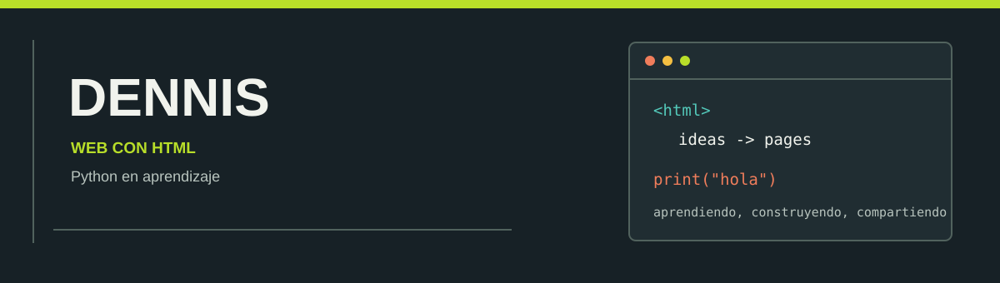

  

<h2 align="center">Construyendo para la web, aprendiendo algo nuevo cada día.</h2>

  Me gusta crear cosas para la web. HTML es mi punto fuerte y ahora estoy aprendiendo Python con proyectos pequeños.

  
  

---

## Ahora mismo

| Mi base | Mi siguiente paso |
|:--|:--|
| **HTML** · estructura y contenido web | **Python** · fundamentos y práctica con proyectos |

## Mi ruta

- Crear páginas web claras y bien organizadas.
- Practicar programación con Python, paso a paso.
- Compartir mis proyectos y contar cómo los construí.

## Próximo objetivo

Estoy preparando mis primeros proyectos para publicarlos aquí. Mientras tanto, puedes seguir mi progreso en [mis repositorios](https://github.com/denniscaiza?tab=repositories).

  Aprendiendo haciendo · Dennis

